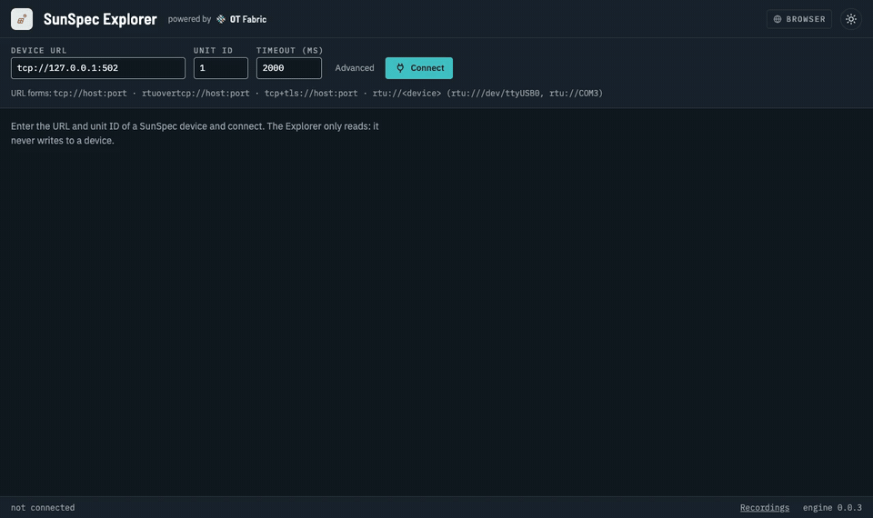
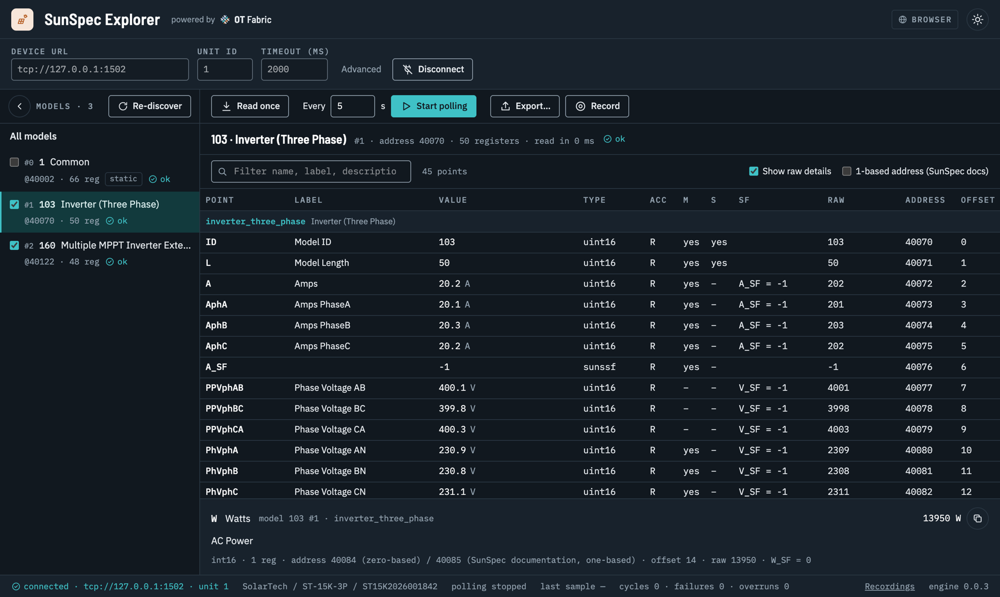
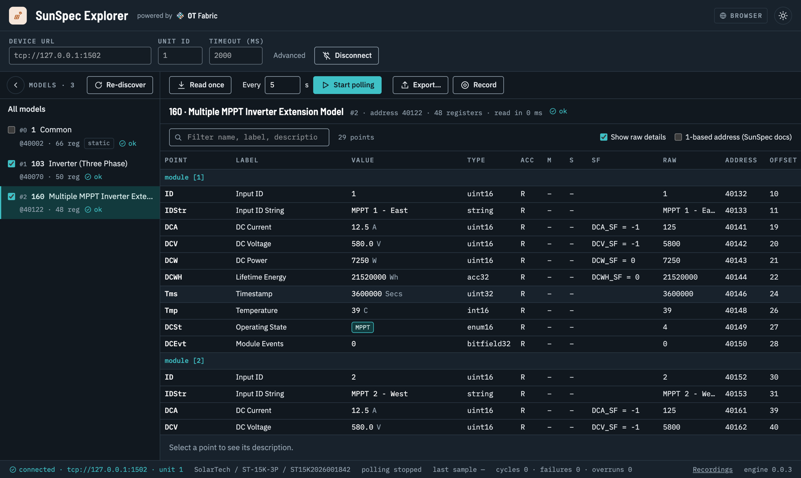
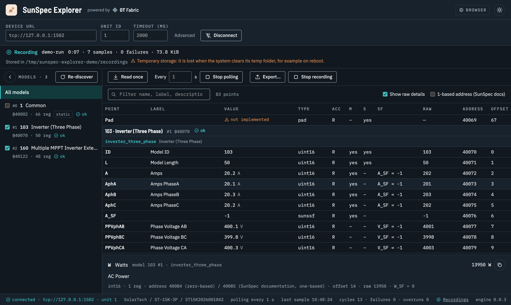
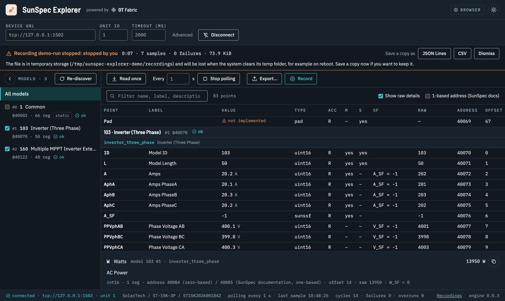
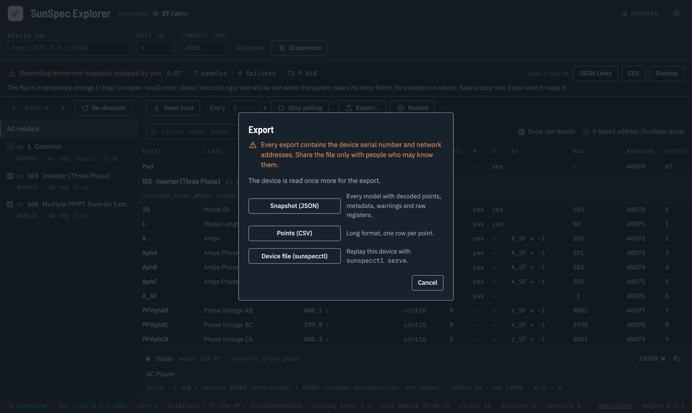
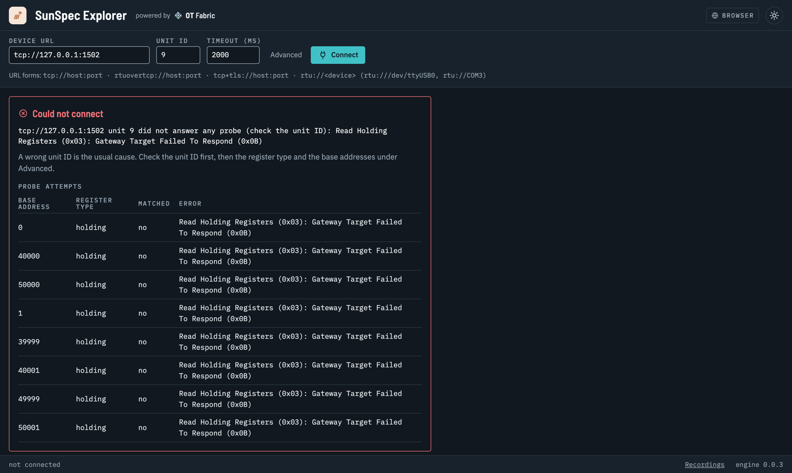

# SunSpec Explorer

**Connect to a SunSpec inverter, meter or battery, see every model it exposes fully decoded, read once or poll, record and export, without ever writing to the device.**

Built by OT Fabric on [go-sunspec](https://github.com/otfabric/go-sunspec) and [go-modbus](https://github.com/otfabric/go-modbus). MIT licensed. **Status: preview**; the current release is on the [releases page](https://github.com/otfabric/sunspec-explorer/releases/latest).



*The demo above, in full quality: [`docs/media/demo.mp4`](docs/media/demo.mp4) (one minute, against a device simulated with `sunspecctl serve`).*

## Two ways to run it

The same Explorer, with the same features and the same screens, comes in two forms. Pick by where the device is.

| | **Desktop application** (`sunspec-explorer`) | **Daemon + browser** (`sunspec-explorerd`) |
|---|---|---|
| What it is | A native window on your computer | A small server, with the user interface in any browser |
| Talks to the device from | Your computer | The machine the daemon runs on, typically a gateway next to the device |
| Use it when | The device is on your network or your serial port | The device is only reachable from a gateway; or your desktop cannot run the application (Debian 11/12); or you want to leave polling and recording running |
| Runs on | macOS, Windows, Linux desktop | Linux gateways (amd64, arm64, armv7; Debian 11, 12, 13), or anywhere as a container |
| Reaching it | Start it | `ssh -N -L 8765:127.0.0.1:8765 user@gateway`, then open the URL the daemon gives you |
| Installed on your computer | The application | Nothing: a browser is enough |

There is no "remote mode" in the desktop application: remote use is always the daemon and a browser. Both forms only **read** (Modbus function codes 3 and 4); the client refuses anything else before it reaches the wire. See [`SECURITY.md`](SECURITY.md).

## What you can do

| | |
|---|---|
|  |  |
| **Browse decoded models.** Label, value with units, scale factor, enum and bitfield names, access, mandatory and static flags, raw value and register address of every point; a description per point. Not-implemented points are labeled as such, never shown as 65535. | **Repeating and nested groups** appear as instances (`module [1]`, `module [2]`, `Crv [1] / Pt [3]`). Models without a known schema show their raw registers. |
|  |  |
| **Poll** at whole-second intervals, in the engine, never overlapping; stale values are marked. **Record** the samples as JSON Lines, with a warning when the storage is temporary. | **Save a copy** of a recording as JSON Lines or CSV when it stops. On the daemon a recording keeps running when you close the browser or the tunnel drops. |
|  |  |
| **Export** a snapshot (JSON, with a [published schema](docs/schema/)), the points as CSV, or a device file that `sunspecctl serve` turns back into the same device. | **A failed connect shows every probe** and its error, and says that a wrong unit ID is the usual cause. |

Also: targets over Modbus/TCP, RTU over TCP, Modbus/TCP Security (TLS) and serial RS-485; a light theme ([screenshot](docs/images/light.png)) and full keyboard navigation; a collapsible model list; re-discovery when a device's model chain changes.

## Install

Every release has the files below, a checksum file (`sunspec-explorer-<version>-checksums.txt`) and build provenance. The files are **not code-signed yet**, so macOS and Windows warn on the first start; the steps for that are under each platform.

| Platform | Desktop application | Daemon |
|---|---|---|
| macOS 13 or later, Apple silicon | `sunspec-explorer-<version>-darwin-arm64.zip` | container image |
| macOS 13 or later, Intel | `sunspec-explorer-<version>-darwin-amd64.zip` | container image |
| Windows 10 or 11, x64 | `sunspec-explorer-<version>-windows-amd64.zip` | container image |
| Windows 11 on ARM | `sunspec-explorer-<version>-windows-arm64.zip` (best effort) or the x64 build | container image |
| Linux desktop, x86-64 / arm64 | `sunspec-explorer-<version>-linux-amd64.tar.gz` / `-linux-arm64.tar.gz` (GTK 4, WebKitGTK 6.0) | `sunspec-explorerd-<version>-linux-amd64.tar.gz` / `-linux-arm64.tar.gz` |
| Linux gateway, x86-64 / arm64 / armv7 | — | `sunspec-explorerd-<version>-linux-amd64.tar.gz` / `-linux-arm64.tar.gz` / `-linux-armv7.tar.gz` |
| Any machine with Docker | — | `ghcr.io/otfabric/sunspec-explorerd` (amd64, arm64, armv7) |

All downloads are on the [releases page](https://github.com/otfabric/sunspec-explorer/releases/latest). The commands below fetch the latest release and check its checksum.

### macOS: desktop application

```sh
VERSION=$(curl -fsSL https://api.github.com/repos/otfabric/sunspec-explorer/releases/latest | sed -n 's/.*"tag_name": *"v\([^"]*\)".*/\1/p')
ARCH=$(uname -m | sed 's/x86_64/amd64/')            # arm64 or amd64
FILE="sunspec-explorer-${VERSION}-darwin-${ARCH}.zip"
BASE="https://github.com/otfabric/sunspec-explorer/releases/download/v${VERSION}"
curl -fsSLO "${BASE}/${FILE}" && curl -fsSLO "${BASE}/sunspec-explorer-${VERSION}-checksums.txt"
grep " ${FILE}\$" "sunspec-explorer-${VERSION}-checksums.txt" | shasum -a 256 -c -
ditto -x -k "${FILE}" /Applications
open "/Applications/SunSpec Explorer.app"
```

The app is not notarized. If macOS refuses to open it, go to System Settings → Privacy & Security and choose "Open Anyway" once, or remove the quarantine flag: `xattr -dr com.apple.quarantine "/Applications/SunSpec Explorer.app"` (a file downloaded with `curl` usually has none).

### Windows: desktop application

In PowerShell:

```powershell
$version = (Invoke-RestMethod https://api.github.com/repos/otfabric/sunspec-explorer/releases/latest).tag_name.TrimStart('v')
$file    = "sunspec-explorer-$version-windows-amd64.zip"
$base    = "https://github.com/otfabric/sunspec-explorer/releases/download/v$version"
Invoke-WebRequest "$base/$file" -OutFile $file
Invoke-WebRequest "$base/sunspec-explorer-$version-checksums.txt" -OutFile checksums.txt
$expected = ((Select-String -Path checksums.txt -Pattern " $file$").Line -split '\s+')[0]
if ((Get-FileHash $file -Algorithm SHA256).Hash -ne $expected.ToUpper()) { throw "checksum mismatch" }
Expand-Archive $file -DestinationPath "$env:LOCALAPPDATA\Programs\SunSpec Explorer" -Force
& "$env:LOCALAPPDATA\Programs\SunSpec Explorer\sunspec-explorer-$version-windows-amd64\sunspec-explorer.exe"
```

SmartScreen shows "Windows protected your PC" the first time: choose "More info", then "Run anyway". Windows 10 needs the [WebView2 runtime](https://developer.microsoft.com/microsoft-edge/webview2/); Windows 11 has it. Serial devices are named `COM3` and the like; the application lists them.

### Linux: desktop application

The desktop application needs GTK 4 and WebKitGTK 6.0: Debian 13, Ubuntu 24.04 or later. On Debian 11 or 12 use the daemon on the same machine and a browser (next section).

```sh
sudo apt install libgtk-4-1 libwebkitgtk-6.0-4
VERSION=$(curl -fsSL https://api.github.com/repos/otfabric/sunspec-explorer/releases/latest | sed -n 's/.*"tag_name": *"v\([^"]*\)".*/\1/p')
ARCH=$(dpkg --print-architecture)                    # amd64 or arm64
FILE="sunspec-explorer-${VERSION}-linux-${ARCH}.tar.gz"
BASE="https://github.com/otfabric/sunspec-explorer/releases/download/v${VERSION}"
curl -fsSLO "${BASE}/${FILE}" && curl -fsSLO "${BASE}/sunspec-explorer-${VERSION}-checksums.txt"
grep " ${FILE}\$" "sunspec-explorer-${VERSION}-checksums.txt" | sha256sum -c -
tar xzf "${FILE}" && sudo install -m 0755 "${FILE%.tar.gz}/sunspec-explorer" /usr/local/bin/
sunspec-explorer
```

For serial devices your user needs the `dialout` group (`sudo usermod -aG dialout $USER`, then log in again).

### Linux gateway: the daemon

One static binary per architecture, no libraries, no display: the same file runs on Debian 11, 12 and 13.

```sh
VERSION=$(curl -fsSL https://api.github.com/repos/otfabric/sunspec-explorer/releases/latest | sed -n 's/.*"tag_name": *"v\([^"]*\)".*/\1/p')
ARCH=$(dpkg --print-architecture | sed 's/armhf/armv7/')   # amd64, arm64 or armv7
FILE="sunspec-explorerd-${VERSION}-linux-${ARCH}.tar.gz"
BASE="https://github.com/otfabric/sunspec-explorer/releases/download/v${VERSION}"
curl -fsSLO "${BASE}/${FILE}" && curl -fsSLO "${BASE}/sunspec-explorer-${VERSION}-checksums.txt"
grep " ${FILE}\$" "sunspec-explorer-${VERSION}-checksums.txt" | sha256sum -c -
tar xzf "${FILE}" && sudo install -m 0755 "${FILE%.tar.gz}/sunspec-explorerd" /usr/local/bin/
sunspec-explorerd version
```

Try it with `sunspec-explorerd` (it listens on `127.0.0.1:8765`), or run it as a service with the systemd unit in the archive (`sunspec-explorerd.service`); both are described in [`docs/REMOTE-USE.md`](docs/REMOTE-USE.md). The daemon connects only to private and link-local addresses by default (`--allow-target` adds others) and opens serial devices only when you name them (`--allow-serial '/dev/ttyUSB*'`).

### Any platform: the daemon as a container

The quickest way to try the browser form, also on macOS and Windows:

```sh
docker run -d --name explorer -p 127.0.0.1:8765:8765 -v explorer-data:/data ghcr.io/otfabric/sunspec-explorerd:latest
docker exec explorer sunspec-explorerd url      # the address to open, access token included
```

Publish the port on `127.0.0.1` only, as shown. From the container, a device on your own machine is `host.docker.internal`. More in [`docs/REMOTE-USE.md`](docs/REMOTE-USE.md#in-a-container).

### Check what you downloaded (optional)

Besides the checksum, each file has a build provenance attestation that proves the release workflow of this repository built it:

```sh
gh attestation verify sunspec-explorerd-<version>-linux-arm64.tar.gz --repo otfabric/sunspec-explorer
gh attestation verify oci://ghcr.io/otfabric/sunspec-explorerd:<version> --repo otfabric/sunspec-explorer
```

## Remote use in three steps

Nothing is installed on your workstation:

```sh
gateway$      sunspec-explorerd                              # listens on 127.0.0.1:8765
workstation$  ssh -N -L 8765:127.0.0.1:8765 user@gateway     # forward the port, keep it running
gateway$      sunspec-explorerd url                          # prints http://127.0.0.1:8765/#token=...
```

Open that URL in a browser on the workstation. The part after `#` is the access token: treat the URL like a password. When the tunnel drops, the daemon keeps polling and recording, and the page picks up where it left off. Details, systemd, TLS and serial devices, Debian notes: [`docs/REMOTE-USE.md`](docs/REMOTE-USE.md).

## Try it without hardware

[`sunspecctl`](https://github.com/otfabric/sunspecctl) can simulate a device:

```sh
sunspecctl template --model 1,103,160 -o device.json     # then fill in some values
sunspecctl serve --file device.json --url tcp://127.0.0.1:1502
```

In the desktop application, connect to `tcp://127.0.0.1:1502`, unit ID 1. For the daemon, allow the local address, which is off by default: `sunspec-explorerd --allow-target 127.0.0.0/8`. The demo and the screenshots above were made exactly this way.

## Build from source

Go 1.25 or later and Node.js 22 or later; for the desktop application also a C compiler and the platform's webview (Xcode command line tools, the WebView2 runtime, or GTK 4 and WebKitGTK 6.0).

```sh
make frontend-install   # once
make dev                # build the user interface and run the desktop application
make build              # ./bin/sunspec-explorer and ./bin/sunspec-explorerd
make bundle-macos       # ./bin/SunSpec Explorer.app
make build-daemon-all   # the daemon for linux amd64, arm64 and armv7
make docker             # the daemon's container image
make check              # all checks
```

## Documentation

- [Remote use](docs/REMOTE-USE.md): the daemon, SSH, systemd, containers, serial and TLS devices
- [JSON Schemas](docs/schema/): snapshot, recording, API
- [Requirements](docs/REQUIREMENTS.md), [Architecture](docs/ARCHITECTURE.md), [Branding](docs/BRANDING.md), [Proposal review](docs/PROPOSAL-REVIEW.md)
- [Release notes](RELEASE.md), [Security](SECURITY.md), [Contributing](CONTRIBUTING.md); agents start with [`AGENTS.md`](AGENTS.md)

License: MIT.
